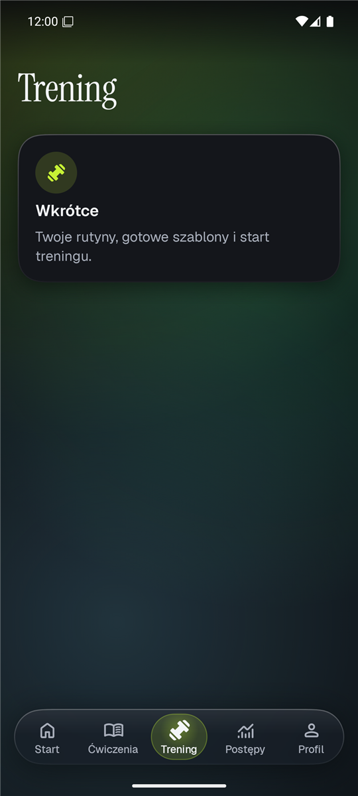
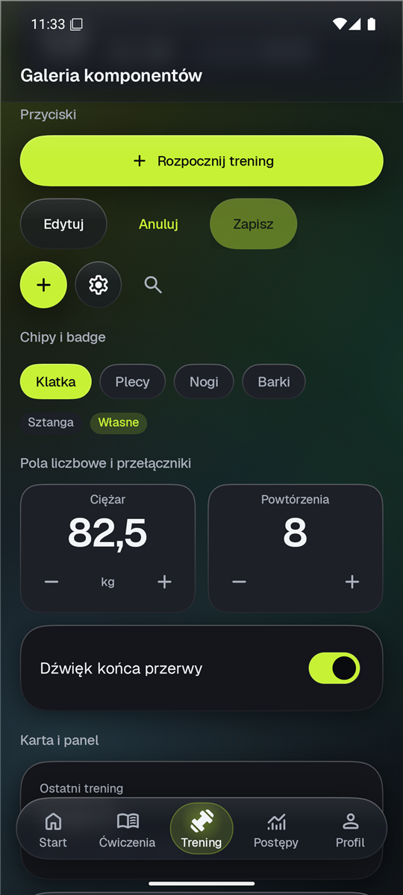
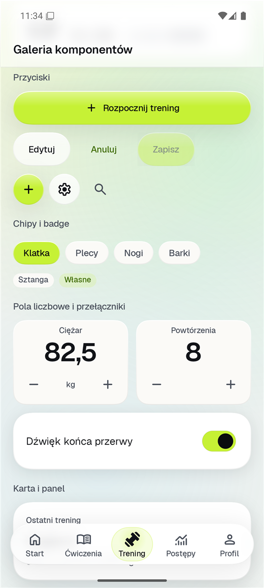

# GymTracker v2

Natywna aplikacja na Androida do śledzenia treningów siłowych. Działa lokalnie, integruje się z Health Connect (dane z Samsung Health i Galaxy Watch) i ma design „liquid glass”: prawdziwe rozmycie tła pod pływającymi warstwami, ciemne tło z subtelną aurorą i duże, tabularne liczby.

> Szkic. Projekt jest w budowie, etapami opisanymi w `PROMPT.md`. Stan prac: `docs/PROGRESS.md`.
>
> Gotowe: design system i nawigacja (Etap 1), baza ćwiczeń z wyszukiwarką, filtrami i własnymi ćwiczeniami (Etap 2), rutyny z wariantami, drag & drop i gotowymi szablonami (Etap 3), aktywny trening z przerwą, podsumowaniem i podpowiedzią progresji (Etap 4).

<p>
  
  
  
</p>

## Funkcje (plan)

- Rutyny i szablony (Push/Pull/Legs, Upper/Lower, FBW), bloki z wariantami ćwiczeń.
- Aktywny trening z timerem przerwy, powiadomieniem i Live Update (Now Bar w One UI).
- Baza 902 ćwiczeń: free-exercise-db (zdjęcia z CDN, cache na dysku) i warianty z programów Jeffa Nipparda; wyszukiwanie także po polskich nazwach, filtry partii ciała i sprzętu, własne ćwiczenia.
- Historia, rekordy, szacowany 1RM, wykresy postępów.
- Health Connect: tętno, sen, HRV, skład ciała, kroki. Dane zdrowotne nie opuszczają telefonu.
- Kopia zapasowa do pliku i aktualizacje z GitHub Releases.

## Stack

- Kotlin, Jetpack Compose, Material 3 (mocno przestylowany), single-activity, edge-to-edge, predictive back.
- minSdk 35, targetSdk 36, compileSdk 37.
- Navigation 3 (osobny stos na każdą zakładkę), Hilt, kotlinx.serialization.
- Szkło: [Kyant Backdrop](https://github.com/Kyant0/AndroidLiquidGlass) i Kyant Shapes (narożniki o ciągłej krzywiźnie).
- Fonty: Geist (UI i liczby, cyfry tabularne) oraz Instrument Serif (duże nagłówki), obie na licencji OFL.
- Ikony: Material Symbols Rounded jako vector drawable.

- Room 3 (sterownik systemowego SQLite), Coil 3 z OkHttp.

Kolejne biblioteki (DataStore, WorkManager, Health Connect) dochodzą w etapach, które ich potrzebują. Wersje: `gradle/libs.versions.toml`, uzasadnienia: `docs/DECISIONS.md`.

## Budowanie

Wymagania: Android Studio 2026.2 lub nowsze (JBR 25), Android SDK z platformą 37.

```powershell
.\gradlew.bat assembleDebug          # APK debug: app\build\outputs\apk\debug
.\gradlew.bat testDebugUnitTest      # testy jednostkowe
.\gradlew.bat :app:connectedDebugAndroidTest  # testy UI na emulatorze
.\gradlew.bat lintDebug              # lint
adb install -r app\build\outputs\apk\debug\app-debug.apk
```

Wariant debug ma identyfikator `com.jaroszeek.gymtracker.debug`, więc instaluje się obok wersji release.

### Galeria komponentów (tylko debug)

W launcherze pojawia się osobna ikona „GT Galeria” ze wszystkimi komponentami i przełącznikami motywu. Motyw można też ustawić z linii poleceń, np. do zrzutów ekranu:

```powershell
adb shell am start -n com.jaroszeek.gymtracker.debug/com.jaroszeek.gymtracker.designsystem.gallery.GalleryActivity --es palette onyx --ez reduceTransparency true
```

Parametry: `palette` (volt, ember, rose, aqua, azure, amber, onyx, porcelain), `mode` (system, light, dark), `amoled`, `dynamic`, `reduceTransparency`.

W galerii jest też sonda Live Update: publikuje powiadomienie z prośbą o promocję i pokazuje stany, od których zależy pokazanie go w Now Bar.

### Pomiar płynności

```powershell
.\gradlew.bat :baselineprofile:connectedBenchmarkAndroidTest
```

Macrobenchmark przewija galerię pod szklanym navbarem na buildzie `benchmark` (R8), z rozmyciem i bez niego. Miarodajny jest tylko wynik z telefonu.

## Struktura

```
app/src/main/java/com/jaroszeek/gymtracker/
  designsystem/theme/      tokeny: palety, typografia, odstępy, kształty, blur, ruch
  designsystem/component/  komponenty glass, navbar
  navigation/              zakładki i stosy Navigation 3
  core/                    baza Room, DI
  domain/                  czysta logika (modele, wyszukiwanie)
  data/                    repozytoria, seed
  feature/                 ekrany funkcji
app/src/debug/             galeria komponentów i sonda Live Update
baselineprofile/           macrobenchmarki (w Etapie 10 także Baseline Profile)
docs/                      postęp, decyzje, pomysły, zrzuty ekranu
```

## Licencje

Kod aplikacji: do ustalenia przed wydaniem. Baza ćwiczeń: [free-exercise-db](https://github.com/yuhonas/free-exercise-db) (Unlicense, domena publiczna). Fonty Geist i Instrument Serif: SIL Open Font License 1.1 (teksty licencji w `app/src/main/assets/licenses/`). Ikony Material Symbols: Apache-2.0.
