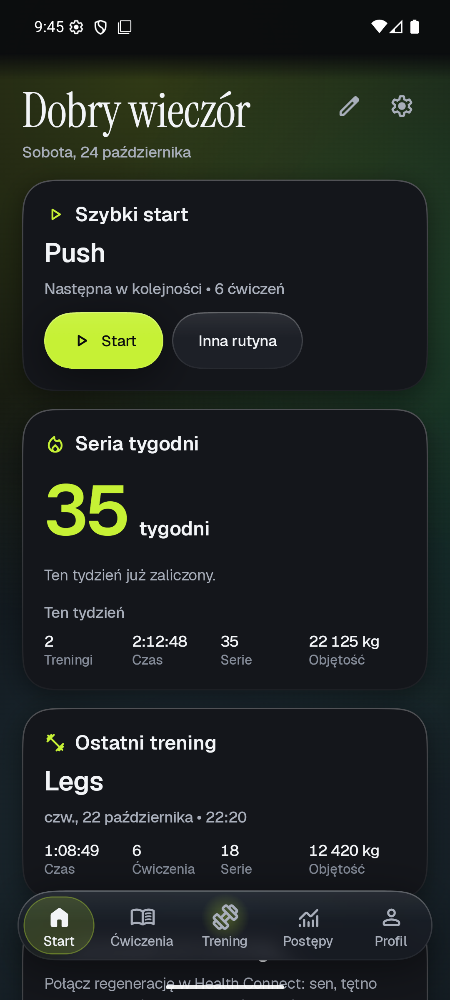
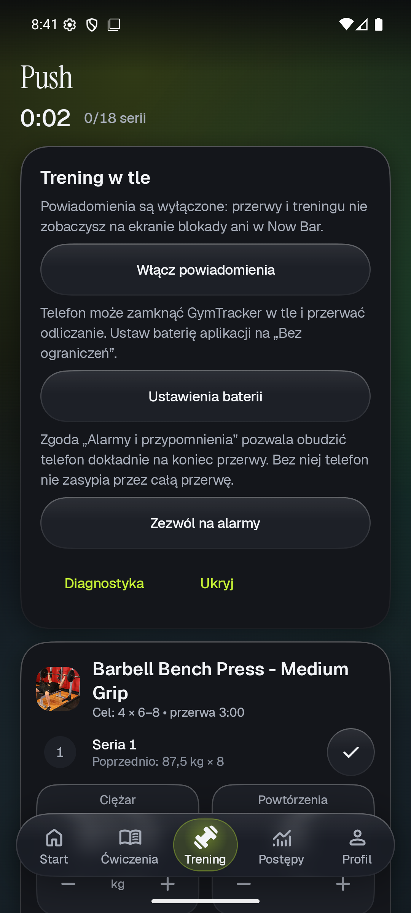
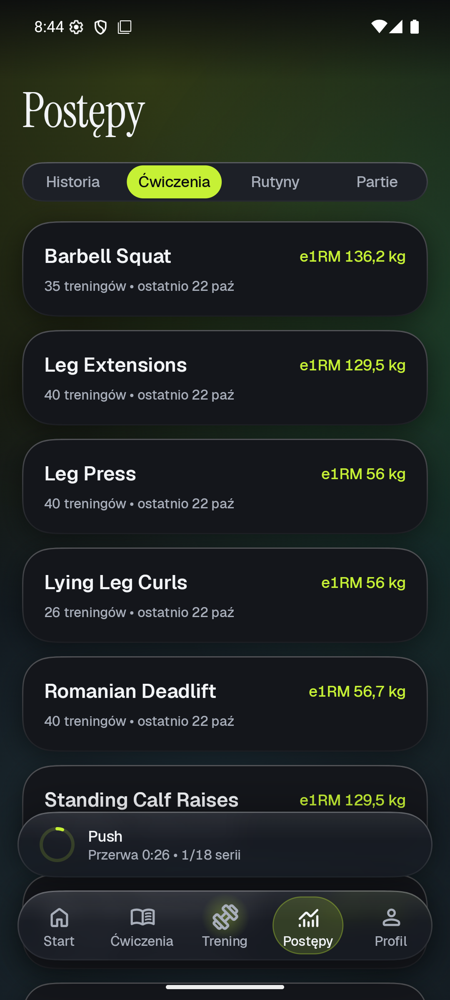
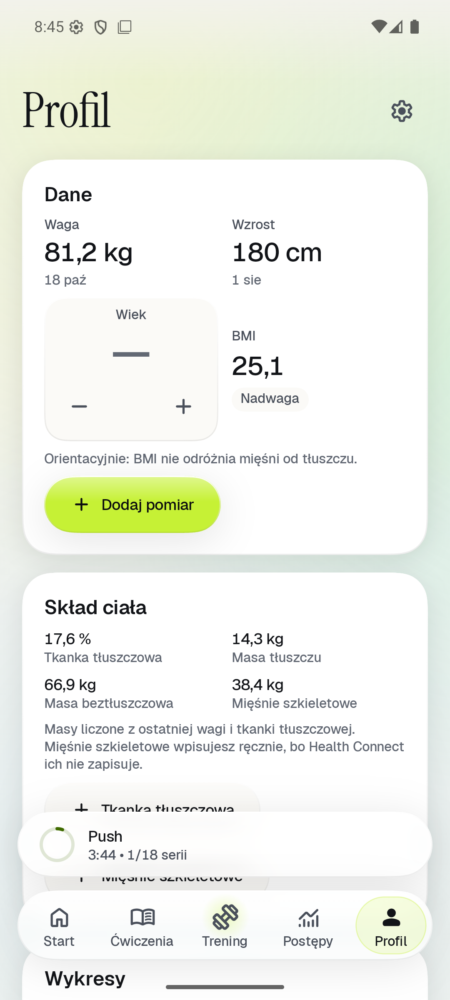

# GymTracker v2

Natywna aplikacja na Androida do śledzenia treningów siłowych. Działa lokalnie, integruje się z Health Connect (dane z Samsung Health i Galaxy Watch) i ma design „liquid glass”: prawdziwe rozmycie tła pod pływającymi warstwami, ciemne tło z subtelną aurorą i duże, tabularne liczby.

Wszystkie dane zostają na telefonie. Aplikacja nie ma konta, analityki ani reklam; sieci używa tylko do zdjęć ćwiczeń i (od v1.0.0) do sprawdzania aktualizacji na GitHubie.

<p>
  
  
  
  
</p>

## Funkcje

- **Start:** seria tygodni, statystyki tygodnia, ostatni trening, kalendarz aktywności, kroki, waga z BMI, gotowość do treningu i rekordy z 7 dni. Widżety można przestawiać i ukrywać. „Szybki start” proponuje następną rutynę.
- **Rutyny i szablony:** bloki z wariantami ćwiczeń (np. sztanga albo hantle), cele serii, powtórzeń, ciężaru i przerwy, przeciąganie. Gotowe szablony Push/Pull/Legs, Upper/Lower i FBW.
- **Aktywny trening:** serie z typem (rozgrzewkowa, robocza, drop set, do upadku), podpowiedź z poprzedniej sesji, podpowiedź progresji (double progression), rekordy w trakcie treningu, podsumowanie i aktualizacja celów rutyny. Trening przetrwa zamknięcie aplikacji.
- **Przerwa:** pełnoekranowy timer z pierścieniem, odliczanie w powiadomieniu na żywo (Live Update, Now Bar na Samsungu) i na ekranie blokady, wibracja i dźwięk na koniec także przy wygaszonym ekranie.
- **Ćwiczenia:** 902 ćwiczenia (free-exercise-db ze zdjęciami i warianty z programów Jeffa Nipparda), wyszukiwanie także po polskich nazwach, filtry partii i sprzętu, własne ćwiczenia, wykres i rekordy każdego ćwiczenia.
- **Historia i postępy:** szczegóły i edycja treningów, rekordy, szacowany 1RM (Epley, Brzycki), wykresy z zakresami i przeciąganiem, postęp rutyn, tygodniowe serie na partię.
- **Health Connect:** sesje z zegarka z tętnem, strefami i kaloriami, łączenie ich z treningami, pomiary ciała, kroki, sen, tętno spoczynkowe i HRV. Opcjonalny zapis treningów do Health Connect.
- **Profil:** waga, wzrost, wiek, BMI, skład ciała, wykresy i dziennik pomiarów (ręcznych i z Health Connect, bez duplikatów).
- **Ustawienia:** motyw (systemowy, jasny, ciemny), 6 akcentów i motywy Onyx i Porcelain, AMOLED, Material You, „Ogranicz przezroczystość”, kg albo lb, domyślna przerwa, dźwięk i wibracja.
- **Kopia zapasowa:** eksport całej bazy do pliku i import z kontrolą pliku, podsumowaniem i kopią poprzednich danych. Ten sam przycisk przyjmuje kopię z pierwszej wersji GymTrackera.

## Instalacja APK

Wymaga Androida 15 lub nowszego.

1. Na telefonie otwórz [Releases](https://github.com/Jaroszeek/GymTrackerv2/releases) i pobierz plik `.apk` z sekcji „Assets”.
2. Otwórz pobrany plik i zezwól przeglądarce albo menedżerowi plików na instalowanie nieznanych aplikacji.
3. Sumę SHA-256 pliku podaje opis wydania.

Wydania `preview-stage-<nr>` to wersje testowe (APK debug, aplikacja „GymTracker Debug”), które instalują się obok wersji docelowej. Pierwsze właściwe wydanie to v1.0.0; kolejne wersje zainstaluje aktualizator w aplikacji (Ustawienia → Aktualizacje).

## Stack

- Kotlin, Jetpack Compose, Material 3 (mocno przestylowany), single-activity, edge-to-edge, predictive back.
- minSdk 35, targetSdk 36, compileSdk 37.
- Navigation 3 (osobny stos na każdą zakładkę), Hilt, kotlinx.serialization.
- Szkło: [Kyant Backdrop](https://github.com/Kyant0/AndroidLiquidGlass) i Kyant Shapes (narożniki o ciągłej krzywiźnie).
- Fonty: Geist (UI i liczby, cyfry tabularne) oraz Instrument Serif (duże nagłówki), obie na licencji OFL.
- Ikony: Material Symbols Rounded jako vector drawable.

- Room 3 (sterownik systemowego SQLite), Coil 3 z OkHttp.

- DataStore (ustawienia, układ Startu, flagi aplikacji).
- Health Connect (`connect-client`) i WorkManager (synchronizacja w tle).

Wersje: `gradle/libs.versions.toml`, uzasadnienia: `docs/DECISIONS.md`.

## Budowanie

Wymagania: Android Studio 2026.2 lub nowsze (JBR 25), Android SDK z platformą 37.

```powershell
.\gradlew.bat assembleDebug          # APK debug: app\build\outputs\apk\debug
.\gradlew.bat testDebugUnitTest      # testy jednostkowe
.\gradlew.bat :app:connectedDebugAndroidTest  # testy UI na emulatorze
.\gradlew.bat lintDebug              # lint
adb install -r app\build\outputs\apk\debug\app-debug.apk
```

Wariant debug ma identyfikator `com.jaroszeek.gymtracker.debug`, więc instaluje się obok wersji release.

### Galeria komponentów (tylko debug)

Galeria ze wszystkimi komponentami i przełącznikami motywu nie ma ikony w launcherze (D-058). Otwiera się ją z linii poleceń, a parametrami można od razu ustawić motyw, np. do zrzutów ekranu:

```powershell
adb shell am start -n com.jaroszeek.gymtracker.debug/com.jaroszeek.gymtracker.designsystem.gallery.GalleryActivity --es palette onyx --ez reduceTransparency true
```

Parametry: `palette` (volt, ember, rose, aqua, azure, amber, onyx, porcelain), `mode` (system, light, dark), `amoled`, `dynamic`, `reduceTransparency`.

W galerii jest też sonda Live Update: publikuje powiadomienie z prośbą o promocję i pokazuje stany, od których zależy pokazanie go w Now Bar.

### Wydajność

```powershell
# Baseline Profile (emulator albo telefon)
.\gradlew.bat :app:generateReleaseBaselineProfile
# zimny start bez profilu i z profilem
.\gradlew.bat :baselineprofile:connectedBenchmarkReleaseAndroidTest "-Pandroid.testInstrumentationRunnerArguments.class=com.jaroszeek.gymtracker.baselineprofile.StartupBenchmark"
# przewijanie pod szklanym navbarem, z rozmyciem i bez
.\gradlew.bat :baselineprofile:connectedBenchmarkAndroidTest "-Pandroid.testInstrumentationRunnerArguments.class=com.jaroszeek.gymtracker.baselineprofile.GlassScrollBenchmark"
```

Profil (`app/src/release/generated/baselineProfiles`) jest w repo i trafia do każdego buildu release. Generator uruchamia aplikację i przechodzi przez wszystkie zakładki; po większych zmianach ekranów warto go puścić ponownie (D-079). Benchmark przewijania używa buildu `benchmark` (R8), z rozmyciem i bez niego. Miarodajny jest tylko wynik z telefonu.

## Health Connect (Samsung Health, Galaxy Watch)

GymTracker czyta z Health Connect:
- sesje z zegarka z tętnem i kaloriami;
- pomiary ciała;
- kroki i dystans;
- sen, tętno spoczynkowe i HRV.

Na tej podstawie pokazuje tętno, strefy i kalorie przy treningu połączonym z sesją z zegarka, a także sesje z zegarka w historii i orientacyjną gotowość do treningu. Dane zostają na telefonie w osobnej bazie, wyłączonej z kopii systemowej. Bez Health Connect i bez zgód aplikacja działa normalnie. Opcjonalnie zapisuje zakończone treningi do Health Connect (domyślnie wyłączone).

Konfiguracja Samsung Health → Health Connect:
1. Samsung Health → Ustawienia → Health Connect: zezwól Samsung Health na zapis danych, najlepiej wszystkich. Health Connect jest też w Ustawieniach telefonu (wyszukaj „Health Connect”).
2. Dane z Galaxy Watch trafiają do Health Connect przez Samsung Health, więc pojawią się po synchronizacji zegarka z telefonem.
3. Health Connect → Dane i dostęp → kategoria (np. Aktywność) → Źródła danych i priorytet: Samsung Health na górze. Sumy kalorii i kroków Health Connect liczy tylko z aplikacji z tej listy.
4. GymTracker → Profil → Health Connect → „Połącz” przy funkcji, której chcesz używać. Bez zgody „Starsze dane” Health Connect udostępnia tylko dane z 30 dni przed pierwszym połączeniem.

Samsung Health przekazuje do Health Connect m.in.:
- sesje ćwiczeń z tętnem;
- kroki;
- sen z fazami;
- wagę i skład ciała;
- kalorie.

Tętna spoczynkowego i HRV Samsung nie wymienia na liście danych udostępnianych w Health Connect. Jeśli nie przychodzą, gotowość opiera się na śnie.

Dane testowe na emulatorze daje build `benchmark` (inny pakiet, więc jego dane wyglądają jak z zegarka, D-066):

```powershell
.\gradlew.bat assembleBenchmark
adb install -r app\build\outputs\apk\benchmark\app-benchmark.apk
"EXERCISE","HEART_RATE","ACTIVE_CALORIES_BURNED","TOTAL_CALORIES_BURNED","STEPS","DISTANCE","WEIGHT","SLEEP","RESTING_HEART_RATE","HEART_RATE_VARIABILITY" | ForEach-Object { adb shell pm grant com.jaroszeek.gymtracker.benchmark "android.permission.health.WRITE_$_" }
# sesja siłowa w podanym przedziale (epoch ms; bez parametrów ostatnie 50 min), spacer i 9 dni snu, tętna spoczynkowego, HRV, kroków i wagi
adb shell am start -n com.jaroszeek.gymtracker.benchmark/com.jaroszeek.gymtracker.HealthSeedActivity --el start <ms> --el end <ms>
adb logcat -d -s HealthSeed
```

## Powiadomienie treningu i Now Bar (One UI)

W trakcie treningu działa usługa pierwszoplanowa z cichym powiadomieniem: nazwa rutyny, „ćwiczenie • seria”, czas treningu, pasek postępu serii, a w czasie przerwy odliczanie i akcja „Pomiń przerwę”. Powiadomienie prosi system o promocję do Live Update (powiadomienie na żywo), więc na Androidzie 16 QPR1 (36.1) i nowszym po wyjściu z aplikacji widać go na pasku stanu jako chip z zegarem (czas treningu, w przerwie odliczanie), a na Samsungu w Now Bar. Koniec przerwy wibruje także przy wygaszonym ekranie.

Samsung dokłada własne przełączniki. Żeby trening był widoczny w Now Bar:

1. **Powiadomienia aplikacji** włączone (prośba przy pierwszym starcie; potem: Ustawienia → Aplikacje → GymTracker → Powiadomienia).
2. **Powiadomienia na żywo dla aplikacji**: w ustawieniach powiadomień GymTrackera przełącznik powiadomień na żywo (Live notifications / Live updates). Na Androidzie 16 QPR1 to systemowy ekran, który otwiera przycisk „Powiadomienia na żywo” w diagnostyce.
3. **Now Bar**: Ustawienia → Ekran blokady i AOD → Now Bar. GymTracker musi być na liście aplikacji, które mogą się tam pokazywać.
4. **Opcja programisty „Live notifications for all apps”**: na części wersji One UI aplikacje spoza listy Samsunga trafiają do Now Bar dopiero po jej włączeniu (Ustawienia → Opcje programisty; opcje programisty włącza się, stukając 7 razy w „Numer wersji” w Ustawienia → Telefon — informacje → Informacje o oprogramowaniu).
5. **Bateria „Bez ograniczeń”**: Ustawienia → Aplikacje → GymTracker → Bateria. Inaczej One UI potrafi zamknąć aplikację w tle i przerwać odliczanie.
6. **Alarmy i przypomnienia** (opcjonalnie): Ustawienia → Aplikacje → GymTracker → Alarmy i przypomnienia. Z tą zgodą koniec przerwy budzi telefon dokładnym alarmem; bez niej telefon nie zasypia przez całą przerwę (blokada uśpienia).

Nazwy pozycji różnią się między wersjami One UI. Stan wszystkich warunków pokazuje ekran **Diagnostyka powiadomień na żywo** (przycisk na dole ekranu treningu) i zapisuje go w logu:

```powershell
adb logcat -s LiveUpdate WorkoutService RestAlarm Workout
```

Najważniejsze pozycje: „Zgoda na powiadomienia na żywo” (`canPostPromotedNotifications`), „Powiadomienie spełnia wymagania” (`hasPromotableCharacteristics`) i „Powiadomienie jest na żywo” (`FLAG_PROMOTED_ONGOING`). Gdy dwie pierwsze są na „Tak”, a trzecia na „Nie”, promocję blokuje ustawienie systemu albo One UI.

## Struktura

```
app/src/main/java/com/jaroszeek/gymtracker/
  designsystem/theme/      tokeny: palety, typografia, odstępy, kształty, blur, ruch
  designsystem/component/  komponenty glass, navbar
  navigation/              zakładki i stosy Navigation 3
  core/                    baza Room, DataStore, DI, powiadomienie treningu i przerwa w tle
  domain/                  czysta logika (modele, wyszukiwanie)
  data/                    repozytoria, seed
  feature/                 ekrany funkcji
app/src/debug/             galeria komponentów i sonda Live Update
baselineprofile/           macrobenchmarki i generator Baseline Profile
docs/                      postęp, decyzje, pomysły, zrzuty ekranu
```

## Licencje

Kod aplikacji: do ustalenia przed wydaniem. Baza ćwiczeń: [free-exercise-db](https://github.com/yuhonas/free-exercise-db) (Unlicense, domena publiczna). Fonty Geist i Instrument Serif: SIL Open Font License 1.1 (teksty licencji w `app/src/main/assets/licenses/`). Ikony Material Symbols: Apache-2.0.
